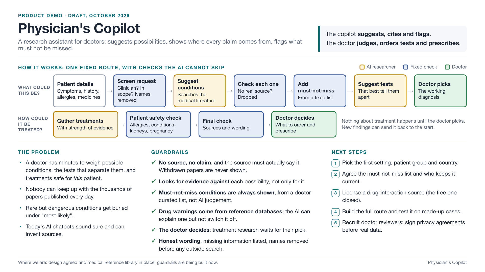

# diagnostic-agent

A physician's copilot: it suggests possible diagnoses, tests and treatments, links each claim to its source,
and leaves every decision to the doctor.

[](docs/demo__deck.pdf)

One-page overview as [PDF](docs/demo__deck.pdf) (source: [docs/demo__deck.html](docs/demo__deck.html)).
Full detail: [docs/product-spec.md](docs/product-spec.md).

## Run

```bash
make langfuse   # local Langfuse on :3000; .env already points at it
make dev
make eval
make ci         # lint, test, build, scan, deploy locally, smoke test
```

Add `OPENROUTER_API_KEY` to `.env`. For CI, set repo secrets `LANGFUSE_PUBLIC_KEY`, `LANGFUSE_SECRET_KEY`,
`OPENROUTER_API_KEY` (plus `TYPESAFE_API_KEY` once `evals/gate.yaml` has judge questions) and variable
`LANGFUSE_BASE_URL` (Langfuse Cloud or your self-hosted URL).

Note: Langfuse currently holds only the eval datasets and experiment runs. Tracing of the copilot's
responses through Langfuse is planned for a later iteration.

## Layout

- `app/`: API, agent graph, tools, guardrails, retrieval, memory
- `packs/<client>/`: client-specific rules, prompts and templates (`PACK=<client>`)
- `evals/`: golden cases and the eval runner
- `frontend/`: React UI, served by the API in production
